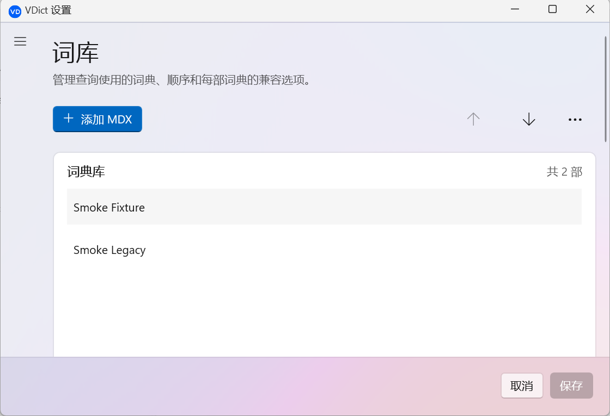

  

<h1 align="center">VDict</h1>

A simple, local-first MDX/MDD dictionary reader for Windows.

<a href="README.md">简体中文</a>

VDict uses WinUI 3 and WebView2 to display dictionary entries and SQLite to
build a local suggestion index. It supports fast lookup and multi-dictionary
search. Your dictionaries and settings stay on your device, with no account or
cloud service required.

## ✨ Highlights

- **Fast lookup**: A local index provides instant suggestions, exact lookup, redirects, and query history.
- **Multiple dictionaries**: Manage and search several `.mdx` dictionaries together, including companion `.mdd` images and audio.
- **Rich content**: Display dictionary images, styles, scripts, audio, and relative resources while preserving the original layout where possible.
- **Privacy first**: No account, telemetry, or cloud sync; dictionaries, history, settings, and indexes stay on your device.
- **Safer content handling**: External navigation, downloads, and Web messages from dictionary content are restricted and require an explicit user action.
- **Modern Windows interface**: Built with WinUI 3 and WebView2, with light, dark, and system themes plus configurable fonts and reader appearance.
- **Multiple languages**: Choose Chinese, English, or follow the Windows display language.
- **Portable use**: Extract and run; user data is kept together in the `Data/` directory for easier migration and backup.

## Requirements

- Windows 10 version 1809 or later, x64.
- Microsoft Edge WebView2 Evergreen Runtime `120.0.2210.0` or later.

## 📦 Download and use

After the first release, users with repository access can download
`VDict-0.1.0-win-x64-portable.zip` from [Releases](../../releases/latest).

1. Extract the complete archive to a writable directory.
2. Run `VDict.exe`.
3. Open **Settings → Dictionaries** and add an `.mdx` file. Companion resources
   in the same directory are discovered according to the configured format rules.

The portable build stores settings, indexes, caches, logs, and WebView2 data in
the `Data/` directory next to the executable. Preserve that directory when
upgrading. See the [portable-build guide](docs/PORTABLE.md) for details.

Only the portable ZIP is currently distributed. No installer is provided.

## 🔒 Privacy and security

VDict contains no telemetry, accounts, cloud sync, or remote database. The
application does not upload queries, dictionary contents, settings, or local
paths. External links, downloads, and Web messages from dictionary content are
restricted by separate policies and require explicit user interaction.

To reduce risks from third-party dictionary content, VDict restricts scripts,
external navigation, and resource access.

## ⚠️ Current limitations

- Windows x64 builds only.
- Extensions produced by different MDX/MDD tools may have compatibility differences.
- For safety, VDict limits dictionary scripts and external content, so dictionaries
  that depend on browser extensions may not work completely.

## 💬 Feedback

- Report bugs and suggest features through [Issues](../../issues).
- Release changes are recorded in the [changelog](CHANGELOG.md).

## About this project

VDict was generated and developed by its author with AI assistance. AI
contributed to parts of the code, tests, and documentation. Final product
decisions, review, and releases remain the responsibility of the maintainer.

VDict is available under the [MIT License](LICENSE). See
[THIRD-PARTY-NOTICES.md](THIRD-PARTY-NOTICES.md) for third-party software.
