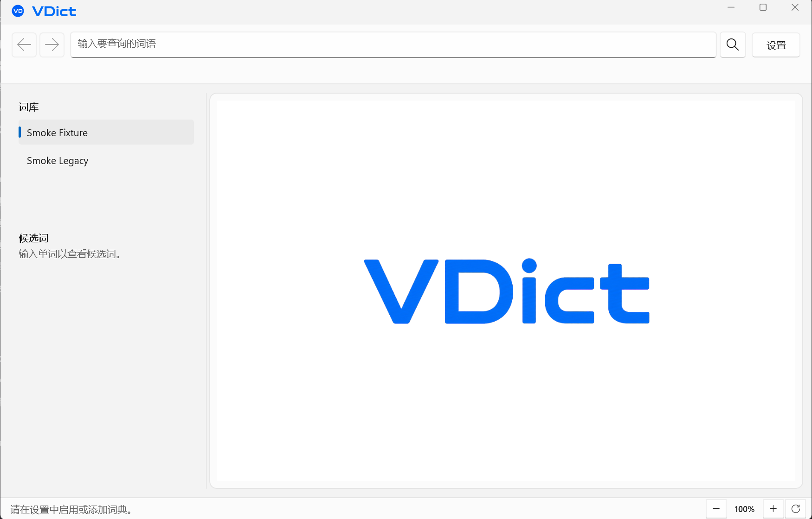

  

<h1 align="center">VDict</h1>

<strong>A local-first, offline MDX/MDD dictionary reader for Windows</strong>

  <a href="../../releases/latest">Download latest</a> ·
  <a href="docs/PORTABLE.md">User guide</a> ·
  <a href="README.md">简体中文</a>

VDict uses WinUI 3 and WebView2 to display dictionary entries and SQLite to
build a local suggestion index. It supports fast lookup and multi-dictionary
search. Dictionaries, query history, and settings stay on your device, with no
account or cloud service required.

## Highlights

- **MDX/MDD reading**: Load `.mdx` dictionaries and companion `.mdd` images, audio, and other resources.
- **Fast lookup**: Get instant suggestions from a local index, with exact lookup, redirects, and query history.
- **Multiple dictionaries**: Manage and search several dictionaries together.
- **Modern Windows interface**: Use light, dark, or system themes and adjust fonts and reader appearance.
- **Local first**: No account, telemetry, or cloud sync; your data stays on your device.

## Quick start

1. Download the portable package ending in `win-x64-portable.zip` from [Releases](../../releases/latest).
2. Extract the complete archive to a writable directory.
3. Run `VDict.exe`.
4. Open **Settings → Dictionaries** and add an `.mdx` file.

> VDict does not provide or distribute dictionary files. Companion `.mdd`
> resources should usually be placed in the same directory as the `.mdx` file.

## Compatibility and requirements

| Item | Status |
| --- | --- |
| Windows 10 version 1809 or later, x64 | Supported |
| MDX dictionaries and MDD resources | Supported |
| Images, audio, styles, and relative resources | Supported |
| Dictionaries that depend on scripts or external content | May be limited by security policies |
| WebView2 Evergreen Runtime | Version `120.0.2210.0` or later required |

Extensions produced by different MDX/MDD tools may have compatibility differences.

## Privacy and data

- VDict contains no telemetry, accounts, cloud sync, or remote database.
- The application does not upload queries, dictionary contents, settings, or local paths.
- Settings, indexes, caches, logs, and WebView2 data are stored in the `Data/` directory next to the application.
- Preserve the `Data/` directory when upgrading to keep your existing data.

Scripts, external navigation, downloads, and Web messages from dictionary content
are restricted by security policies. External actions require explicit user
interaction. See the [portable-build guide](docs/PORTABLE.md) for details.

## Feedback and license

- Report bugs and suggest features through [Issues](../../issues).
- Release changes are recorded in the [changelog](CHANGELOG.md).
- VDict is available under the [MIT License](LICENSE). See
  [THIRD-PARTY-NOTICES.md](THIRD-PARTY-NOTICES.md) for third-party software.

VDict is developed by its author with AI assistance. Final product decisions,
review, and releases remain the responsibility of the maintainer.
