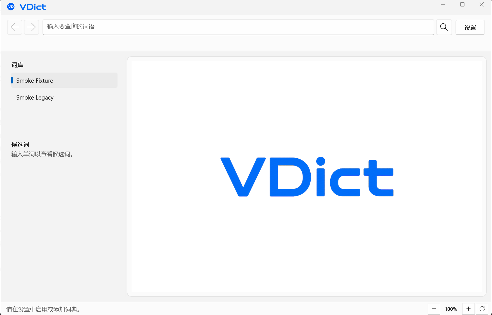
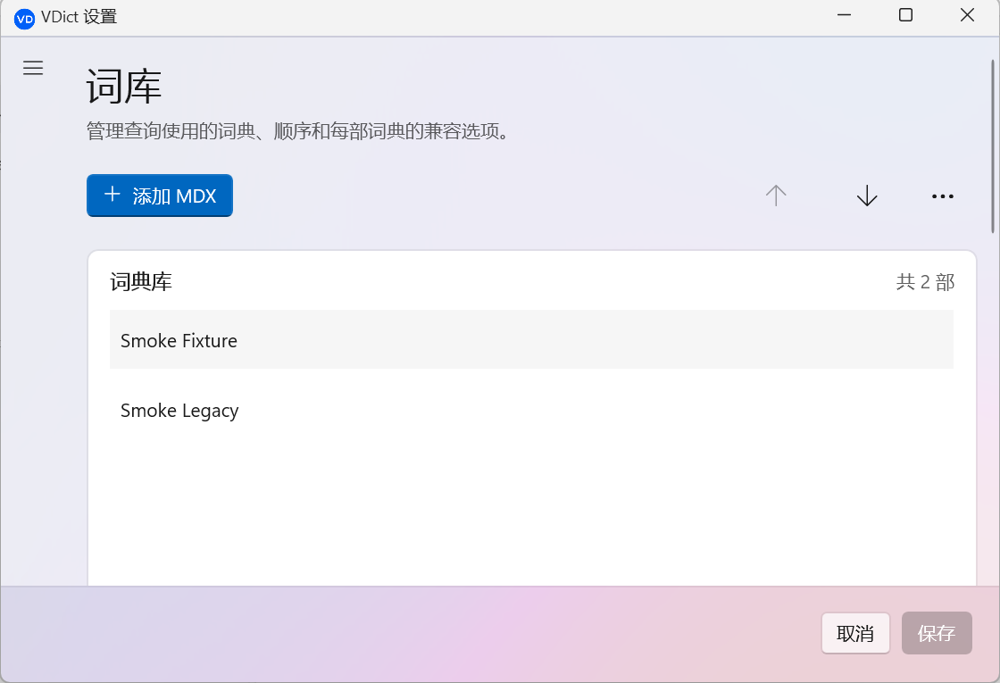

  

<h1 align="center">VDict</h1>

一款简洁、本地优先的 Windows MDX/MDD 词典阅读器。

<a href="README.en.md">English</a>

VDict 使用 WinUI 3 和 WebView2 展示词典正文，通过 SQLite 建立本地候选索引，
支持快速检索和多词典查询。词典与设置保存在本机，无需注册账号或连接云端服务。

## ✨ 功能特点

- **快速查询**：使用本地索引即时显示候选词，支持精确查询、词条重定向和查询历史。
- **多词典阅读**：可同时管理和查询多部 `.mdx` 词典，并加载配套 `.mdd` 图片、音频等资源。
- **完整内容显示**：支持词典内的图片、样式、脚本、音频和相对资源，尽量还原原始排版。
- **隐私优先**：无需账号，不含遥测和云同步；词典、查询记录、设置及索引都保存在本机。
- **安全防护**：限制词典内容发起的外部跳转、下载和 Web 消息，相关操作需要用户明确触发。
- **现代化界面**：采用 WinUI 3 和 WebView2，支持浅色、深色和跟随系统主题，并可调整字体与正文显示。
- **多语言支持**：提供中文、English 和跟随 Windows 显示语言三种选项。
- **便携使用**：解压即可运行，用户数据集中保存在程序旁的 `Data/` 目录，迁移和备份更方便。

## 系统要求

- Windows 10 1809 或更高版本，x64。
- Microsoft Edge WebView2 Evergreen Runtime `120.0.2210.0` 或更高版本。

## 📦 下载与使用

首个版本发布后，可从有权访问本仓库的 [Releases](../../releases/latest) 下载
`VDict-0.1.0-win-x64-portable.zip`。

1. 将压缩包完整解压到可写目录。
2. 运行 `VDict.exe`。
3. 打开“设置 → 词典”，添加 `.mdx` 文件；同目录配套资源会按设置和格式规则发现。

便携版会把设置、索引、缓存、日志和 WebView2 数据保存到程序旁的 `Data/`。
升级时保留该目录即可。详细说明见[便携版文档](docs/PORTABLE.md)。

当前仅提供便携 ZIP，不提供安装版。

## 🔒 隐私与安全

VDict 不包含遥测、账户、云同步或远程数据库。查询词、词典内容、设置和本地路径
不会由应用上传。词典正文中的外部链接、下载和 Web 消息受到独立策略限制；
外部操作需要明确的用户交互。

为了降低第三方词典内容带来的风险，VDict 会限制脚本、外部导航和资源访问。

## ⚠️ 当前限制

- 仅提供 Windows x64 构建。
- 不同 MDX/MDD 生成工具的扩展行为可能存在兼容性差异。
- 为了降低风险，VDict 会限制词典内脚本和外部内容；依赖浏览器扩展能力的词典可能无法完全工作。

## 💬 问题反馈

- 遇到错误或有功能建议，可以在 [Issues](../../issues) 中反馈。
- 版本变化见[变更日志](CHANGELOG.md)。

## 关于项目

VDict 由作者借助 AI 辅助生成和开发。AI 参与了部分代码、测试与文档的生成，
最终的功能取舍、内容审核和版本发布由项目维护者负责。

VDict 使用 [MIT License](LICENSE)。第三方组件及许可证见
[THIRD-PARTY-NOTICES.md](THIRD-PARTY-NOTICES.md)。
