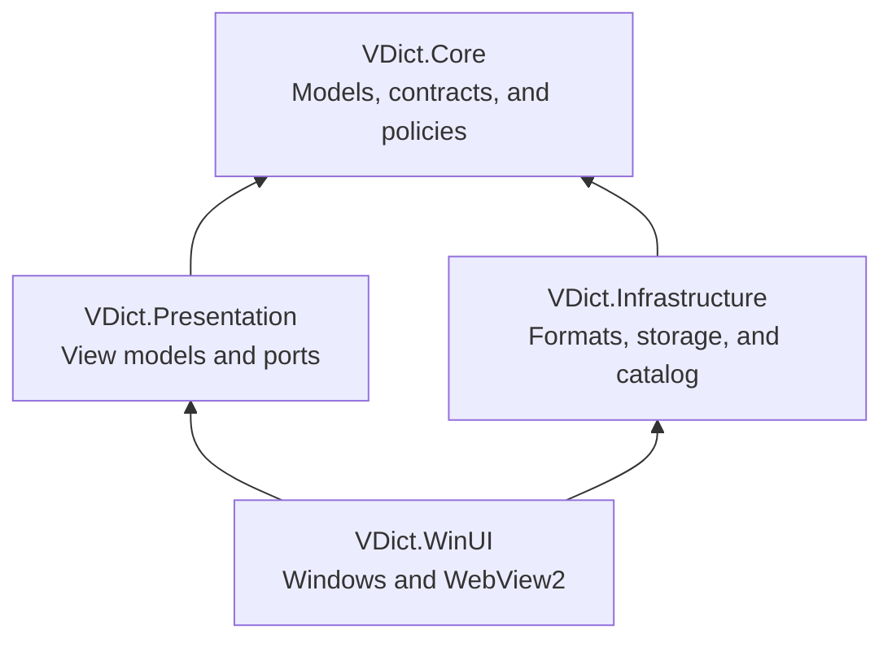
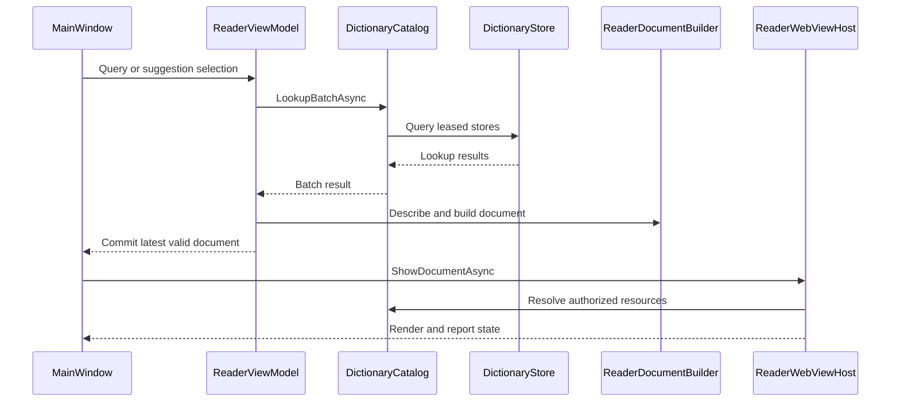

# VDict architecture

VDict uses a layered Windows desktop architecture with immutable public models
and interfaces in `VDict.Core` as its inner boundary.

## Projects and dependency direction

- **Core** does not depend on windows, WebView2, SQLite, or a concrete storage layout.
- **Infrastructure** implements JSON settings, MDX/MDD reading, SQLite indexes,
  catalog snapshots, caches, logs, and maintenance.
- **Presentation** coordinates queries, settings drafts, and platform-independent
  UI state without creating windows or accessing files directly.
- **WinUI** owns dependency injection, windows, file pickers, WebView2 lifetime,
  localization resources, and Windows platform adapters.
- **RemediationFixture** is an offline test tool and is not part of production startup.

## Startup

1. The application detects packaged or portable mode.
2. It reads the selected UI language before XAML initialization.
3. The composition root registers localization, settings, catalog, cache,
   platform, view-model, and WebView2 services.
4. The main window activates, application data paths are created, and settings
   are loaded and migrated.
5. The catalog validates enabled dictionaries, prepares indexes, opens stores,
   and publishes the first immutable generation.
6. The reader becomes available and WebView2 initializes after layout is ready.

## Lookup and rendering

Suggestions are debounced. Full lookups use a latest-wins queue, and responses
are rejected when their request or catalog generation is stale.

## Settings and consistency

Settings use a prepare/commit flow:

1. normalize and validate the draft;
2. check files and duplicate dictionaries;
3. prepare missing indexes and trial stores;
4. compare the base revision;
5. atomically save settings and promote indexes;
6. publish a new immutable catalog generation.

Concurrent edits use a three-way merge. Old dictionary stores remain alive
until all query leases have been released.

## Content security boundaries

- Dictionary documents use synthetic origins and isolated per-dictionary hosts.
- Resource URLs bind dictionary identity, catalog generation, and an in-process capability.
- File resolution rejects drive paths, traversal, NUL input, and reparse-point escapes.
- External navigation, downloads, and Web messages have separate validation and
  short-lived user-activation gates.
- Dictionary content, paths, queries, URLs, and protocol values are not localized.

VDict has no server API, account system, cloud database, or telemetry pipeline.
Its external runtime dependencies are Windows, WebView2, and packages restored by NuGet.
