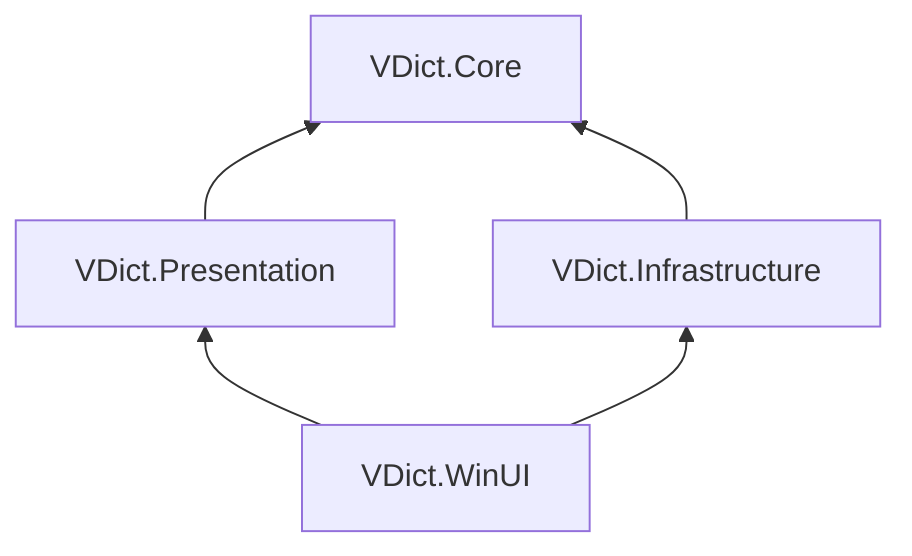

# 生产源代码

## 模块职责

`src/` 包含 VDict 的全部生产代码。四个项目按依赖方向分离领域规则、基础设施、UI 状态和 Windows 外壳，避免内层代码依赖 WinUI 或 WebView2。

## 目录结构

- [`VDict.Core/`](VDict.Core/README.md)：不可变模型、Catalog 契约、设置规则、并发/安全策略和正文转换。
- [`VDict.Infrastructure/`](VDict.Infrastructure/README.md)：JSON 设置、MDX/MDD、SQLite 索引、Catalog、缓存和日志。
- [`VDict.Presentation/`](VDict.Presentation/README.md)：ViewModel、设置编辑会话和平台服务接口。
- [`VDict.WinUI/`](VDict.WinUI/README.md)：应用入口、依赖注入、窗口、WebView2 和 Windows 平台实现。

## 架构与依赖



`VDict.Core` 和 `VDict.Presentation` 不引用具体窗口或 WebView2 UI 类型。`VDict.Infrastructure` 不引用 WinUI；具体平台能力通过 Core 或 Presentation 的接口注入。`VDict.WinUI` 是唯一组合根。

## 主要工作流程

- 启动：WinUI 检测运行模式，轻量读取 `ui_language`；`System` 通过 Core 解析
  Windows UI culture，再在加载 XAML 前应用受支持的 MRT Core 语言覆盖。随后注册
  依赖、创建窗口、加载完整设置并初始化 Catalog。
- 查询：Presentation 接收用户意图，Infrastructure 使用 SQLite 定位词条并读取 MDX，Core 重写正文，WinUI 提交给 WebView2。
- 资源：WebView2 请求被 Presentation 适配器授权，再由 Infrastructure 从同目录文件、MDD 或缓存读取。
- 设置：Presentation 维护草稿，Core 验证和分类，Infrastructure 准备索引并原子
  持久化；WinUI 使用稳定 section、统一下拉框输入和响应式词典主从面板编辑草稿，
  再响应提交事件。
- 关闭：刷新延迟设置，取消后台工作，释放 WebView2、Catalog Store、日志和 DI 容器。

## 配置

- 公共目标框架、nullable、warnings-as-errors 和包缓存路径在 [`Directory.Build.props`](../Directory.Build.props)。
- 集中包版本在 [`Directory.Packages.props`](../Directory.Packages.props)。
- SDK 版本在 [`global.json`](../global.json)。
- 用户设置不是仓库配置；运行时位置由 `IAppDataPaths` 根据 packaged/portable 模式确定。
- UI 文案由 Core 的 `IAppLocalizer` 抽象跨层传递，具体 MRT Core `.resw` 实现和资源只位于 WinUI。

## 测试

生产项目由 [`tests/`](../tests/README.md) 中三个 xUnit 项目覆盖；WinUI 窗口与 WebView2 行为主要由 [`build/`](../build/README.md) 中的 Windows UI 冒烟脚本验证。

```powershell
dotnet test VDict.sln --configuration Release --no-restore
```

## 修改注意事项

- 保持依赖方向；不得让 Core 或 Presentation 引用 WinUI/WebView2。
- 新增领域数据优先使用不可变模型，并同步设置 schema、比较、规范化、迁移和测试。
- 改变 Catalog generation、Store 租约、资源 capability 或路径规则属于安全和并发边界变更，必须补充跨模块测试。
- 修改入口、依赖注入或关闭流程时，同时检查 singleton/scoped 生命周期和异步释放。

## 文档同步要求

项目引用、层次边界、主要入口或跨层数据流变化时，更新本文件、相关项目 README、[`AGENTS.md`](../AGENTS.md) 和 [`docs/ARCHITECTURE.md`](../docs/ARCHITECTURE.md)。

## 相关文档

- [仓库开发约束](../AGENTS.md)
- [文档中心](../docs/README.md)
- [测试总览](../tests/README.md)
